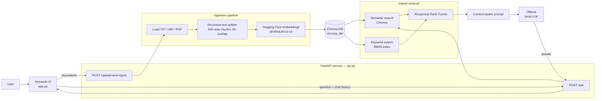

# Hybrid RAG Assistant

A local, open-source Retrieval-Augmented Generation (RAG) assistant for asking questions about your own documents. It combines semantic vector search with BM25 keyword search, then uses Reciprocal Rank Fusion (RRF) to provide relevant context to a local Ollama model.

The project includes a Streamlit chat interface, a FastAPI backend, local Chroma persistence, and optional LangSmith evaluation.

## Highlights

- Keep documents, embeddings, and model inference on your machine.
- Upload and index `.txt`, `.md`, and `.pdf` files from the web interface.
- Combine semantic retrieval (Hugging Face embeddings + Chroma) with keyword retrieval (BM25).
- Re-rank results with Reciprocal Rank Fusion for balanced retrieval.
- Ask follow-up questions with chat history.
- Use a local Ollama model for generation.
- Optionally compare retrieval strategies with LangSmith.

## Architecture



### How a question is answered

1. The UI sends the question and earlier messages to `POST /ask`.
2. The backend searches the persisted Chroma collection semantically and rebuilds a BM25 keyword index from the same chunks.
3. RRF merges the two result lists and selects the top documents.
4. The selected text, question, and chat history are sent to Ollama.
5. The generated answer is returned to the UI. The system prompt instructs the model to answer only from the retrieved context and cite the source material.

## Project structure

```text
hybrid_rag/
├── api.py                 # FastAPI routes, upload handling, and RAG lifecycle
├── app.py                 # Streamlit chat and upload interface
├── src/
│   ├── chain.py           # Prompt construction and Ollama RAG chain
│   ├── config.py          # Environment-based settings
│   ├── ingestion.py       # Document loading and chunking
│   ├── retriever.py       # BM25 + vector retrieval and RRF
│   ├── vectorstore.py     # Embeddings and Chroma persistence
│   └── evaluate.py        # Optional LangSmith evaluation workflow
├── data/                  # Uploaded/source documents (created as needed)
├── chroma_db/             # Persisted vectors (created after ingestion)
├── requirements.txt       # Python dependencies
└── pyproject.toml         # Project metadata and dependencies
```

## Prerequisites

- Python 3.11 or newer
- [Ollama](https://ollama.com/) installed and running
- An Ollama chat model. The default is `llama3.1`.

## Quick start

1. Clone the repository and enter it.

   ```bash
   git clone <your-repository-url>
   cd hybrid_rag
   ```

2. Create and activate a virtual environment.

   **Windows PowerShell**

   ```powershell
   python -m venv .venv
   .\.venv\Scripts\Activate.ps1
   ```

   **macOS / Linux**

   ```bash
   python3 -m venv .venv
   source .venv/bin/activate
   ```

3. Install the project dependencies and the web-server/upload extras.

   ```bash
   pip install -r requirements.txt
   pip install uvicorn python-multipart
   ```

4. Download the default local model.

   ```bash
   ollama pull llama3.1
   ```

   Ollama usually runs as a background service after installation. If it is not running, start `ollama serve` in a separate terminal and leave it open.

5. In one terminal, start the API.

   ```bash
   uvicorn api:app --reload
   ```

6. In a second terminal, start the web app.

   ```bash
   streamlit run app.py
   ```

7. Open the URL shown by Streamlit (normally `http://localhost:8501`), upload documents, click **Upload & Ingest**, and start asking questions.

The interactive API documentation is available at `http://127.0.0.1:8000/docs` while the API is running.

## Configuration

Create a `.env` file in the project root to override the defaults. The file is intentionally ignored by Git.

```env
# Storage
VECTOR_DB_PATH=./chroma_db

# Local generation model
OLLAMA_MODEL=llama3.1

# Embeddings
EMBEDDING_MODEL_NAME=sentence-transformers/all-MiniLM-L6-v2

# Optional LangSmith tracing and evaluation
LANGCHAIN_TRACING_V2=true
LANGCHAIN_ENDPOINT=https://api.smith.langchain.com
LANGCHAIN_API_KEY=
LANGCHAIN_PROJECT=hybrid-rag-opensource
```

| Setting | Default | Purpose |
| --- | --- | --- |
| `VECTOR_DB_PATH` | `./chroma_db` | Directory where Chroma stores embedded chunks. |
| `OLLAMA_MODEL` | `llama3.1` | Locally installed Ollama model used to write answers. |
| `EMBEDDING_MODEL_NAME` | `sentence-transformers/all-MiniLM-L6-v2` | Model that converts document chunks and queries to vectors. |
| `LANGCHAIN_*` | See `.env` example | Optional tracing and evaluation configuration. |

## API reference

### `POST /upload-and-ingest`

Uploads one or more files, saves them under `data/`, splits supported documents into chunks, generates embeddings, and refreshes the RAG chain.

```bash
curl -X POST "http://127.0.0.1:8000/upload-and-ingest" \
  -F "files=@./example.pdf"
```

Supported by the ingestion pipeline: `.txt`, `.md`, `.pdf`.

### `POST /ask`

Answers a question from the indexed documents. `chat_history` is optional and should contain prior `user` or `assistant` messages.

```bash
curl -X POST "http://127.0.0.1:8000/ask" \
  -H "Content-Type: application/json" \
  -d '{
    "question": "What are the main findings?",
    "chat_history": []
  }'
```

Example response:

```json
{
  "answer": "..."
}
```

## Indexing documents from the command line

For batch ingestion, put supported documents in `data/` and run:

```bash
python -m src.ingestion
```

This creates or updates the local Chroma store. Start or restart the API afterward so it loads the latest index.

## Evaluation (optional)

`src/evaluate.py` compares vector-only search, BM25-only search, and hybrid RRF retrieval using a LangSmith dataset. Set `LANGCHAIN_API_KEY` first, then run:

```bash
pip install langsmith
python -m src.evaluate
```

The script records Recall@4, an LLM-judged faithfulness score, and latency for each strategy.

## Troubleshooting

| Problem | What to check |
| --- | --- |
| `Vector store is empty` | Upload/index at least one supported document before asking a question. |
| Cannot connect to FastAPI | Start `uvicorn api:app --reload` and keep it running on port 8000. |
| Ollama/model error | Run `ollama serve`, then verify the configured model is available with `ollama list`. |
| Module error for uploads or Uvicorn | Run `pip install uvicorn python-multipart`. |
| No useful answer | Confirm the answer is present in the indexed documents; the assistant is designed not to invent unsupported answers. |

## Privacy and data storage

By default, source files are stored in `data/` and embeddings in `chroma_db/`. Both directories are excluded from Git. Generation is performed by your local Ollama installation. LangSmith is optional; enabling it may send tracing/evaluation data to the configured LangSmith account.

## License

No license file is currently included. Add a license before distributing or reusing this project publicly.
